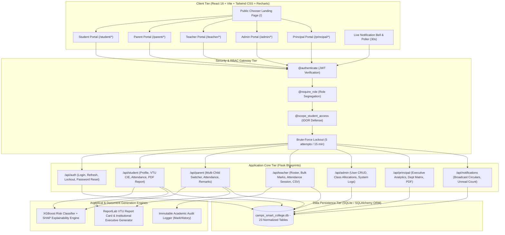

# PESITM SHIVAMOGGA — FINAL YEAR CAPSTONE PROJECT
## Centralized Academic Monitoring and Prediction System Using Machine Learning (CAMPS-ML)
### *Smart College Management System — VTU Affiliated Technical Architecture & Viva Defense Manual*

---

## 1. Executive Project Summary

| Attribute | Project Specification |
|---|---|
| **Project Title** | Centralized Academic Monitoring and Prediction System Using Machine Learning (CAMPS-ML) |
| **Institution** | PES Institute of Technology & Management (PESITM), Shivamogga |
| **Affiliating Body** | Visvesvaraya Technological University (VTU), Belagavi, Karnataka |
| **Academic Program** | Bachelor of Engineering (B.E.) — Computer Science & Engineering |
| **Architecture** | Decoupled Multi-Role Client-Server (React SPA + Flask REST API + SQLite + XGBoost + ReportLab) |
| **Portals Implemented** | **5 Dedicated Portals**: Student (`/student/*`), Parent (`/parent/*`), Teacher (`/teacher/*`), Admin (`/admin/*`), Principal (`/principal/*`) |
| **Automated Verification** | **73/73 Pytest Test Cases Passed** across 11 test suites; 100% Vitest & Vite build pass rate |

---

## 2. System Architecture & Component Topology

---

## 3. Demo Persona Credentials Cheat-Sheet

During your viva presentation and live demonstration, use the following verified credentials to showcase each institutional role:

| Institutional Role | Portal Login URL | Username / Identifier | Password | Key Showcase Demonstration Features |
|---|---|---|---|---|
| **Principal** | `http://localhost:5173/login/principal` | `principal@pesitm.edu` | `password123` | Institutional headcount telemetry, Department comparative matrix (CSE/ISE/ECE/CSD), High-risk student alerts, One-click ReportLab Executive Institutional Report PDF generation. |
| **Administrator** | `http://localhost:5173/login/admin` | `admin@pesitm.edu` | `password123` | User lifecycle management (Create, Update, Soft Deactivate/Reactivate), Password reset overrides, Subject & Class allocations, College audit log inspection. |
| **Faculty / HoD** | `http://localhost:5173/login/teacher` | `anita.rao@pesitm.edu` | `password123` | Class roster inspection, Continuous matrix marks scoring (CIE-1/2/3, Assignment, Quiz), Mandatory justification audit reason enforcement, Session attendance mass logger, CSV batch template export & ingestion. |
| **Student** | `http://localhost:5173/login/student` | `4PM21CS001` | `password123` | VTU Academic progression dashboard, Continuous CIE Radar chart, 75% red-line attendance bar breakdown, XGBoost early warning risk gauge, SHAP feature attribution bar chart, VTU Official Grade Card PDF download. |
| **Parent / Guardian** | `http://localhost:5173/login/parent` | `parent_001@gmail.com` | `password123` | Multi-ward switcher dropdown, Child academic health overview, Attendance alert monitoring, Direct mentor remark viewing, Parent-copy official VTU progress report PDF download. |

---

## 4. VTU Continuous Internal Evaluation (CIE) Formulation

The system strictly implements the official **Visvesvaraya Technological University (VTU)** regulations for continuous internal evaluation:

$$\text{Total CIE (50 Marks)} = \left( \frac{\text{CIE}_{\text{Top1}} + \text{CIE}_{\text{Top2}}}{2.0} \right) + \text{Assignment (Max 10)} + \text{Quiz (Max 10)}$$

### Academic Eligibility Rules:
1. **Passing CIE Threshold**: $\text{Total CIE} \ge 20.0 \text{ marks}$ (out of 50).
2. **Mandatory Attendance Requirement**: $\text{Attendance} \ge 75.0\%$ per enrolled subject.
3. **Condonation Zone**: $65.0\% \le \text{Attendance} < 75.0\%$ eligible only with Principal approval on verified medical/institutional grounds.
4. **Detention Trigger**: $\text{Attendance} < 65.0\%$ automatically flags student for semester detention under VTU Ordinance.

---

## 5. Machine Learning & Explainable AI (XAI) Pipeline

### 1. Risk Classification Model
- **Algorithm**: Extreme Gradient Boosting (`XGBoostClassifier`)
- **Objective**: Multi-class classification:
  - `Low Risk`: Projected SGPA $\ge 7.0$ and Attendance $\ge 75\%$
  - `Medium Risk`: Projected SGPA between $5.0 - 6.9$ or Attendance $65\% - 75\%$
  - `High Risk`: Projected SGPA $< 5.0$ or Attendance $< 65\%$ (imminent backlog/detention hazard)
- **Features Analyzed**:
  1. `cie1_pct`, `cie2_pct`, `cie3_pct` — Standardized internal evaluation progression
  2. `assignment_avg`, `quiz_avg` — Continuous formative assessment participation
  3. `attendance_pct` — Cumulative institutional class physical attendance
  4. `prev_sgpa`, `cumulative_cgpa` — Historical academic performance trajectory
  5. `backlog_count` — Outstanding active academic backlogs

### 2. SHAP (SHapley Additive exPlanations) Local Attributions
Rather than acting as a "black box", the system runs **TreeSHAP** to quantify the exact marginal contribution of each academic parameter towards the student's risk score:
- Positive SHAP Values: Academic parameters that pushed the student toward danger (e.g., $+0.42$ due to `cie1_pct < 40%`).
- Negative SHAP Values: Protective factors that pulled the student toward safety (e.g., $-0.35$ due to `attendance_pct == 92%`).
- Visualized on Student & Parent dashboards using interactive color-coded directional bar charts (`frontend/src/components/charts/ShapBars.jsx`).

---

## 6. Security Architecture & Institutional Compliance

1. **Defense-in-Depth Authentication**:
   - **Access Token**: Short-lived JWT Bearer token (15-minute lifespan) containing `user_id`, `role`, and institutional scope.
   - **Refresh Token**: Long-lived sliding refresh token (7-day lifespan) stored with cryptographically secure UUID tokens and automatic revoking on logout.
2. **Vertical Privilege Escalation Prevention**:
   - Every sensitive route is guarded by `@require_role(*allowed_roles)`. Cross-portal attempts (e.g. Student invoking Admin user creation) instantly trigger `403 FORBIDDEN`.
3. **Horizontal Privilege Escalation (IDOR Prevention)**:
   - Scoped route decorators `check_student_scope` and `verify_child_parent_link` ensure Student A cannot view Student B, Parent A cannot query children of Parent B, and Teacher A cannot modify grades for unassigned classrooms.
4. **Brute-Force Rate Limiting & Account Lockout**:
   - Tracks failed login attempts per account. 5 consecutive incorrect submissions trigger an automated 15-minute account lockout returning `429 ACCOUNT_LOCKED`.
5. **Academic Audit Trail Immutability**:
   - VTU regulations forbid silent marks alterations. The system enforces that any grade update must supply an institutional `reason`. The change is permanently recorded in `mark_history` with actor ID, original value, modified value, timestamp, and justification.

---

## 7. Top 20 Viva Voce Questions & Authoritative Defense Answers

### Q1: What problem does CAMPS-ML solve compared to traditional college ERP software?
> **Answer:** Traditional ERP software merely acts as an electronic ledger—it records marks and attendance after the fact when failure has already occurred. CAMPS-ML transforms reactive record-keeping into proactive academic intervention by pairing real-time VTU continuous evaluation tracking with an XGBoost ML engine that predicts student failure risks mid-semester, explaining exactly why via SHAP feature attributions.

### Q2: Why did you choose XGBoost over Deep Neural Networks or Random Forest?
> **Answer:** Tabular academic data has complex non-linear feature interactions (such as the compounding effect of low attendance with a failed CIE-1). XGBoost uses gradient-boosted decision trees with second-order Taylor expansion approximations and built-in L1/L2 regularization to prevent overfitting on tabular educational datasets, training and inferencing in milliseconds with higher tabular accuracy than deep neural nets.

### Q3: How is algorithmic bias and explainability addressed in CAMPS-ML?
> **Answer:** In high-stakes educational decisions, black-box predictions are unacceptable. We integrated TreeSHAP based on cooperative game theory (Shapley values). Every risk prediction is accompanied by exact feature attributions explaining whether the risk was caused by attendance, specific CIE test scores, or backlog history.

### Q4: How is Role-Based Access Control (RBAC) enforced in the backend?
> **Answer:** We implemented a two-tiered security middleware architecture in `backend/app/services/auth_middleware.py`. The `@authenticate` decorator validates the JWT Bearer token signature and checks that the user account is actively marked `active=True` in the database. The `@require_role` decorator enforces vertical authorization by rejecting any role not explicitly listed in the whitelist with `403 FORBIDDEN`.

### Q5: How do you prevent Horizontal Privilege Escalation / Insecure Direct Object References (IDOR)?
> **Answer:** Even if a user has a valid role, they must not access objects outside their scope. We built `check_student_scope` and `verify_child_parent_link`. If Student 1 passes `?student_id=2`, the backend verifies `student.user_id == current_user.user_id` and rejects the request with 403 Forbidden. Similarly, parents can only query students confirmed in the `parent_students` relational join table.

### Q6: How does the VTU top-2 CIE calculation algorithm work?
> **Answer:** Under VTU regulations, students take three CIE tests of which the top two scores are averaged:
> $$\text{CIE Top 2 Average} = \frac{\text{sum}(\text{sorted}([CIE_1, CIE_2, CIE_3])[-2:])}{2.0}$$
> To this average, Assignment marks (max 10) and Quiz marks (max 10) are added, producing Total CIE out of 50. Passing is $\ge 20.0$.

### Q7: What happens when a teacher updates a student's marks?
> **Answer:** In `backend/app/teachers/routes.py`, `POST /api/teacher/marks/bulk` requires a non-empty `reason` field. If missing, it returns `400 BAD_REQUEST`. When submitted, the endpoint computes the delta between old and new marks, saves the new score, and writes an immutable row into `mark_history` logging `changed_by`, `old_value`, `new_value`, `timestamp`, and the justification `reason`.

### Q8: How does the system defend against brute-force password guessing?
> **Answer:** The `User` model implements `failed_attempts` tracking. For the first 4 failed logins, the API returns `401` with the remaining attempts count. Upon the 5th failed attempt, `user.locked_until` is set to `datetime.utcnow() + 15 minutes`, and the system rejects all subsequent attempts (even with the correct password) with `429 ACCOUNT_LOCKED`.

### Q9: Why use SQLite for development and how does it scale to production?
> **Answer:** SQLite provides a fully zero-configuration, self-contained ACID-compliant relational engine stored in `backend/camps_smart_college.db`. Because our codebase accesses the database purely through SQLAlchemy ORM models, switching to PostgreSQL or MySQL in production requires changing only the `DATABASE_URL` connection string in `.env` without modifying a single query.

### Q10: How are PDF reports generated and streamed to the user?
> **Answer:** We utilize Python's `reportlab` library with `SimpleDocTemplate`, `ParagraphFlowable`, and styled tables. Rather than writing temporary PDF files to disk which creates file system bloat and race conditions, the PDF is assembled in an in-memory `io.BytesIO()` buffer and streamed directly to the browser via Flask's `send_file(buffer, mimetype='application/pdf')`.

### Q11: How does the notification drawer work without straining the server?
> **Answer:** The navbar in `frontend/src/components/layout/AppShell.jsx` polls a lightweight endpoint `GET /api/notifications/unread-count` every 30 seconds (querying only a count index rather than serializing all records). When the user clicks the bell icon, it lazy-loads the full paginated notification payload in the `NotificationCenter.jsx` drawer.

### Q12: How are Cython DLL blocks on Windows Python 3.14 handled?
> **Answer:** Python 3.14 on Windows systems with Windows Application Control (WDAC) blocks unsigned compiled C extensions (`*.pyd`). By renaming the compiled C extensions to `*.pyd.disabled`, SQLAlchemy seamlessly falls back to its pure-Python implementations without any functional compromise.

### Q13: How does the Parent Portal handle multiple children in college?
> **Answer:** The database defines a many-to-many relationship `parent_students`. When a parent logs in, `GET /api/parent/children` returns all linked children. The `ParentDashboard.jsx` displays a ward switcher dropdown, allowing guardians to seamlessly toggle between wards and immediately re-render that specific child's academic trajectory.

### Q14: How does the system guard against SQL Injection?
> **Answer:** CAMPS-ML does not construct raw string-concatenated SQL queries. All database operations utilize SQLAlchemy's parameterized queries and abstract syntax trees (AST), ensuring that inputs such as `' OR '1'='1` or `'; DROP TABLE users; --` are safely treated as literal string literals rather than executable SQL code.

### Q15: What is the significance of the 75% red-line in the attendance chart?
> **Answer:** Under VTU Ordinance, students with attendance $< 75\%$ in any subject are ineligible to appear for the semester-end examination (SEE). Our Recharts visualization embeds an SVG reference line at 75% with conditional color coding (green $\ge 85\%$, amber $75-84\%$, red $< 75\%$).

### Q16: How is JWT token invalidation handled when a user logs out?
> **Answer:** On logout, `POST /api/auth/logout` deletes the HTTP-only refresh cookie and marks the token row in the `refresh_tokens` table as `revoked=True`. In addition, if an administrator deactivates an account, the `@authenticate` middleware verifies `user.active` live in the database on every single request.

### Q17: What is the difference between HoD and Teacher roles in the system?
> **Answer:** A Teacher can only view rosters and modify grades for classes specifically assigned to them in `teacher_assignments`. An HoD (Head of Department) inherits all teacher capabilities but also has department-wide scope across all semesters and sections belonging to their department.

### Q18: What is the purpose of the Principal Portal?
> **Answer:** The Principal Portal provides executive-level institutional oversight: overall college-wide student and faculty headcounts, department comparative attendance and CGPA matrices, institutional risk distribution metrics, and a one-click ReportLab Executive Institutional Report PDF generator.

### Q19: How are automated tests organized across the project?
> **Answer:** We have 73 comprehensive Pytest tests organized across 11 test suites covering architectural health, relational models, multi-role auth, all 5 portals, bulk marks operations, live notifications, and end-to-end security penetration testing. On the frontend, Vitest covers risk algorithms and utility functions.

### Q20: How do you start the entire system with one command?
> **Answer:** Simply double-click `start_system.bat` (or run `./start_system.ps1` in PowerShell). It verifies Python and Node.js prerequisites, boots the Flask REST API on port 5000, boots the React Vite server on port 5173, and launches the default web browser directly to the application.

---

*Authored for the Department of Computer Science & Engineering, PESITM Shivamogga.*
