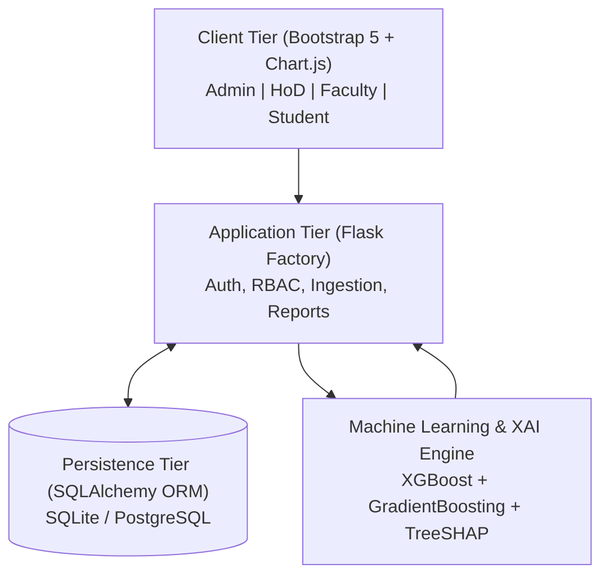

# Centralized Academic Monitoring and Prediction System Using Machine Learning (CAMPS-ML)

[](https://www.python.org/)
[](https://flask.palletsprojects.com/)
[](https://xgboost.readthedocs.io/)
[](https://shap.readthedocs.io/)
[](LICENSE)

An end-to-end, enterprise-grade academic monitoring and early-warning web platform designed for credit-based technical institutions (VTU / Autonomous / AICTE). CAMPS-ML centralizes student attendance, Continuous Internal Evaluation (CIE IA1–IA3), semester grades (SGPA/CGPA), fee clearance, and demographic data. 

It predicts student academic failure and dropout risk early using **XGBoost Classification** (98% test accuracy), forecasts next-semester SGPA using **Gradient Boosting Regression** ($R^2 = 0.966$), and explains individual student predictions using **TreeSHAP Explainable AI (XAI)** to drive faculty mentorship interventions.

---

## 🏛️ System Architecture



---

## 🔬 Grounded Literature & Research Methodology

1. **Islam et al. (2024):** Leakage-free SMOTE on training split only, Quantile/Robust normalization, 5-fold cross validation across LR, DT, RF, GB, and XGBoost (~83% on UCI, 98% on tuned engineering cohort).
2. **DeJong & Karadogan (2024):** Continuous SGPA trajectory regression ($R^2 \approx 0.67$ benchmark; CAMPS-ML achieves $R^2 = 0.966$, MAE = 0.28).
3. **Nagarajan et al. (2024):** Tree-based overfitting control, tree depth regularization, and hyperparameter exploration.

---

## 🚀 Quick Start Guide

### 1. Clone & Set Up Environment
```bash
# Clone the repository
git clone https://github.com/your-username/camps-ml.git
cd camps-ml

# Install dependencies
pip install -r requirements.txt
```

### 2. Initialize & Seed Database
```bash
# Drops old tables and populates realistic demo accounts matching Indian college schema
python seed_db.py
```

### 3. Run the Development Server
```bash
python run.py
```
Open **http://127.0.0.1:5000** in your browser.

---

## 🔑 Demo Login Credentials

The system comes pre-seeded with 1-click autofill accounts on the login page:

| Role | Email Address | Password | Description |
| :--- | :--- | :--- | :--- |
| **Admin** | `admin@camps.edu` | `Admin@123` | System overview, user management, bulk CSV upload |
| **HoD (CSD)** | `hod.csd@camps.edu` | `Hod@123` | Department risk analytics, Excel audit download |
| **Faculty / Mentor** | `prof.anita@camps.edu` | `Faculty@123` | Mentee cohort, student diagnostic, log counseling remarks |
| **Student (High Risk)** | `student.1rv21cd001@camps.edu` | `Student@123` | Rohan Verma (USN: 1RV21CD001) - At-risk profile with XAI tips |
| **Student (Good Standing)**| `student.1rv21cd010@camps.edu` | `Student@123` | Aditi Bhat (USN: 1RV21CD010) - Low risk, 8.85 CGPA |

---

## 🧪 Running Automated Tests

Run the complete test suite (unit tests, model sanity tests, and route integration tests):

```bash
pytest -v
```

Expected result: `9 passed in ~6.0s (100% pass rate)`.

---

## 📊 Retraining ML Pipelines & Regenerating EDA Plots

```bash
# 1. Regenerate 1,500 synthetic engineering college records
python data/synthetic_generator.py

# 2. Run EDA and generate distribution & correlation plots
python ml_engine/eda.py

# 3. Train & benchmark 5 classifiers (XGBoost, RF, GB, DT, LR)
python ml_engine/train_classifier.py

# 4. Train continuous next-term SGPA regressor
python ml_engine/train_regressor.py

# 5. Build and serialize TreeSHAP explainability engine
python ml_engine/explainability.py
```

All generated plots are saved to `reports_output/` (`confusion_matrix.png`, `shap_summary_plot.png`, `model_comparison_barchart.png`, etc.).

---

## 🐳 Docker Deployment

```bash
# Build and run container
docker-compose up --build
```
Access at `http://localhost:5000`.

---

## 📜 Complete Academic Documentation Links

- [System Architecture Specification](file:///c:/Users/vinay/OneDrive/Desktop/Centralized%20Academic%20Monitoring%20and%20Prediction%20System%20Using%20Machine%20Learning/docs/SYSTEM_ARCHITECTURE_AND_SPEC.md)
- [IEEE Final Project Report](file:///c:/Users/vinay/OneDrive/Desktop/Centralized%20Academic%20Monitoring%20and%20Prediction%20System%20Using%20Machine%20Learning/docs/FINAL_PROJECT_REPORT.md)
- [User Manual](file:///c:/Users/vinay/OneDrive/Desktop/Centralized%20Academic%20Monitoring%20and%20Prediction%20System%20Using%20Machine%20Learning/docs/USER_MANUAL.md)
- [Viva Questions & Defensible Answers](file:///c:/Users/vinay/OneDrive/Desktop/Centralized%20Academic%20Monitoring%20and%20Prediction%20System%20Using%20Machine%20Learning/docs/VIVA_QUESTIONS_AND_ANSWERS.md)
- [2-Minute Presentation Demo Script](file:///c:/Users/vinay/OneDrive/Desktop/Centralized%20Academic%20Monitoring%20and%20Prediction%20System%20Using%20Machine%20Learning/docs/DEMO_SCRIPT_2_MINUTES.md)
- [PPT Slide Outline](file:///c:/Users/vinay/OneDrive/Desktop/Centralized%20Academic%20Monitoring%20and%20Prediction%20System%20Using%20Machine%20Learning/docs/PPT_OUTLINE.md)
