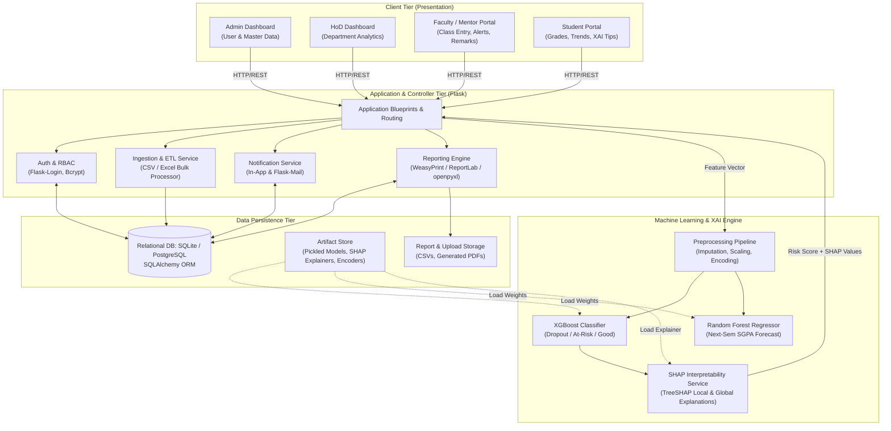
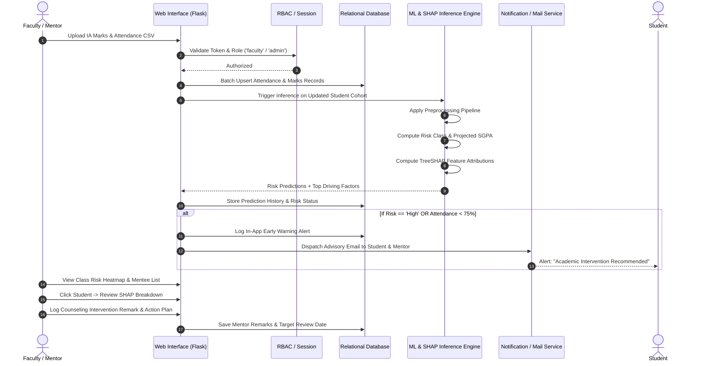

# Centralized Academic Monitoring and Prediction System Using Machine Learning (CAMPS-ML)
## System Architecture & Engineering Blueprint (Phase 0)

---

### 1. Executive Summary & Problem Statement

#### 1.1 Context
In contemporary higher education institutions—especially technical colleges following credit-based semester patterns (e.g., VTU, autonomous, AICTE frameworks)—student academic failure, backlogs, and eventual dropout rarely occur instantaneously. Instead, they manifest as a gradual progression of observable symptoms:
1. Deteriorating lecture and laboratory attendance (<75% statutory threshold).
2. Continuous Internal Evaluation (CIE / IA1-IA3) score depreciation.
3. Arrears/backlogs in prerequisite engineering foundational courses (Mathematics, Data Structures, Circuit Theory).
4. Extraneous socio-economic and institutional barriers (fee payment delinquency, demographic friction, long commutes).

#### 1.2 The Core Problem
Most institutional academic management platforms are purely **retrospective audit logs**. They record marks and attendance after examinations conclude, giving faculty and student advisors zero predictive lead time to intervene. Furthermore:
- **Data Fragmentation:** Attendance registers, internal mark sheets, fee status, and semester grade records reside in disconnected spreadsheets or isolated administrative portals.
- **Absence of Early Warning:** Mentors are typically assigned 20–30 mentees but lack automated triaging systems to pinpoint which student is quietly slipping toward failure.
- **The "Black Box" Barrier:** When predictive ML systems are proposed in literature, they rarely offer interpretability. Faculty cannot trust a raw risk score of "0.82" without knowing *why* (e.g., whether the risk is driven by IA2 drop in Algorithms or sudden absenteeism).

---

### 2. Project Objectives

1. **Centralize Multi-Dimensional Student Data:** Unify demographic profiles, attendance records, continuous internal marks (IA1, IA2, IA3), semester performance history (SGPA/CGPA), and administrative parameters (fee dues, backlogs) in an ACID-compliant relational schema.
2. **Early Dual-Objective Machine Learning Prediction:**
   - **Multi-Class Risk Classification:** Predict student academic fate into three distinct risk tiers:
     - *High Risk / Dropout*
     - *Medium Risk / Academic Probation (Enrolled)*
     - *Low Risk / Normal Progression (Graduate)*
   - **Continuous Next-Semester Performance Regression:** Predict anticipated next-semester SGPA/CGPA to gauge trajectory changes.
3. **Transparent Explainable AI (XAI) Engine:** Deploy TreeSHAP (SHapley Additive exPlanations) and permutation feature importance to generate:
   - **Cohort-level feature rankings** (identifying macro trends across the department).
   - **Individualized local force/waterfall explanations** detailing the exact positive and negative drivers behind a student's risk rating.
4. **Actionable Closed-Loop Intervention Workflow:** Implement an automated early-warning alert system (in-app notifications and automated email triggers for critical thresholds), paired with mentor logging for counselling remarks and measurable intervention tracking.
5. **Auditable Reporting Engine:** Generate downloadable, structured PDF and Excel reports for individual student transcripts, risk audits, and department-level accreditation documentation.

---

### 3. Scope, Limitations & Ethical Considerations

#### 3.1 In-Scope
- Role-based authorization for 4 tiers: **Admin**, **Head of Department (HoD)**, **Faculty/Mentor**, and **Student**.
- Dual dataset pipeline:
  - **Benchmark Track:** UCI *Predict Students' Dropout and Academic Success* dataset (4,424 instances, 36 features) for academic baseline validation.
  - **Operational Track:** Realistic synthetic generator matching Indian engineering institutions (USN, CIE tests, attendance %, lab credits, semester credits, fee status).
- End-to-end data validation, bulk upload (CSV/Excel), interactive visual dashboards (Chart.js), and scikit-learn/XGBoost pipelines saved via Joblib.

#### 3.2 Limitations (Viva Defense Transparency)
- **Cold-Start Problem:** For first-semester students with no prior college exams, predictive confidence relies more heavily on entrance ranking, demographic, and preliminary attendance data until CIE-1 marks are recorded.
- **Curriculum Drift:** Changes in syllabus or grading rubrics require periodic model retraining or calibration.
- **Synthetic Data vs. Production Realities:** While synthetic data realistically models distributions and correlations, real-world edge cases (sudden medical emergencies, personal bereavement) cannot be captured by academic metrics alone.

#### 3.3 Ethical & Privacy Framework
- **Advisory, Not Punitive:** ML outputs are decision-support indicators for faculty counselors, never automated administrative sanctions or grading penalties.
- **Zero Demographic Bias Mandate:** Protected demographic features (gender, socio-economic proxy) are audited to ensure the model does not propagate systemic bias.
- **Data Protection:** Passwords hashed with bcrypt; role-based access control prevents students from viewing peer records or mentor private notes.

---

### 4. Novelty & Research Synthesis

This system is mathematically and procedurally grounded in three recent landmark research studies:

| Reference Study | Core Methodology Adopted | Adaptation in CAMPS-ML |
| :--- | :--- | :--- |
| **Islam et al. (2024)** | • IQR-based outlier curation.<br>• Extra Trees feature ranking (top-20 features).<br>• Leakage-free SMOTE applied strictly on training splits.<br>• Model benchmark across DT, RF, GB, and XGBoost (~83% accuracy). | Standardized scikit-learn `Pipeline` preventing data leakage; SMOTE integrated using `imbalanced-learn`; XGBoost deployed as core classifier; TreeSHAP deployed for local/global attribution. |
| **DeJong & Karadogan (2024)** | • Stratified 80/20 train/test splits.<br>• Quantile transformation for skewed continuous variables.<br>• Random Forest continuous GPA regression ($R^2 \approx 0.67$).<br>• Strategic early intervention after key foundational milestone courses. | Regression pipeline forecasting next-term SGPA; early warning alerts triggered immediately following internal assessment milestones. |
| **Nagarajan et al. (2024)** | • Overfitting control for tree-based models.<br>• Genetic algorithm (GA) and hyperparameter exploration for optimal tree depth and splitting criteria. | Grid/Randomized/GA hyperparameter optimization with 5-fold cross-validation; explicit pruning and regularization to prevent overfitting on smaller cohorts. |

---

### 5. High-Level System Architecture



---

### 6. User Interaction Flow (Sequence Diagram)



---

### 7. Comprehensive Project Directory Structure

```text
Centralized Academic Monitoring and Prediction System Using Machine Learning/
│
├── run.py                        # Application entry point (runs the Flask dev server)
├── config.py                     # Configuration settings (Dev, Testing, Prod, Mail, Secret Keys)
├── requirements.txt              # Pinned Python package dependencies
├── .env.example                  # Template environment variables (DB URLs, Mail keys)
├── .gitignore                    # Git ignore file for Python, env, data, models, and artifacts
│
├── app/                          # Core Flask Application Package (Application Factory Pattern)
│   ├── __init__.py               # Initializes Flask app, extensions (DB, Login, Mail, Migrate)
│   ├── models/                   # SQLAlchemy ORM Models
│   │   ├── __init__.py
│   │   ├── user.py               # User, Role, Profile (Admin, HoD, Faculty, Student)
│   │   ├── academic.py           # Department, Course, Subject, Enrollment
│   │   ├── assessment.py         # AttendanceRecord, InternalMarks (IA1-3), SemesterGrade
│   │   ├── prediction.py         # PredictionLog, RiskScore, ProjectedGPA, SHAPContributions
│   │   └── intervention.py       # MentorRemark, CounselingAction, AlertNotification
│   │
│   ├── blueprints/               # Modular Controller Routes & Views
│   │   ├── __init__.py
│   │   ├── auth/                 # Login, Logout, Password Reset, Profile
│   │   │   ├── __init__.py
│   │   │   └── routes.py
│   │   ├── admin/                # User management, bulk data upload, system audit
│   │   │   ├── __init__.py
│   │   │   └── routes.py
│   │   ├── hod/                  # Department-level analytics, pass/fail trends, mentor stats
│   │   │   ├── __init__.py
│   │   │   └── routes.py
│   │   ├── faculty/              # Class entry, mentee monitoring, intervention logs
│   │   │   ├── __init__.py
│   │   │   └── routes.py
│   │   ├── student/              # Personal academic dashboard, CGPA trend, advice, self-audit
│   │   │   ├── __init__.py
│   │   │   └── routes.py
│   │   └── api/                  # REST endpoints for live async predictions, Chart.js feeds
│   │       ├── __init__.py
│   │       └── routes.py
│   │
│   ├── services/                 # Reusable Business Logic Services
│   │   ├── __init__.py
│   │   ├── data_ingestion.py     # CSV/Excel parser, schema validator, bulk upsert
│   │   ├── alert_service.py      # Threshold checker (<75% att, High Risk), email dispatcher
│   │   ├── prediction_service.py # Loads trained ML models, executes predict() & SHAP
│   │   └── report_service.py     # Generates Student Transcript PDF & Class Excel summaries
│   │
│   ├── static/                   # Static Frontend Assets
│   │   ├── css/
│   │   │   ├── custom.css        # Custom styling, dark/light theme, card widgets
│   │   │   └── bootstrap.min.css # Bootstrap 5 styling
│   │   ├── js/
│   │   │   ├── charts.js         # Chart.js initialization & dynamic AJAX fetchers
│   │   │   ├── alerts.js         # Notification bell polling & dismissals
│   │   │   └── main.js           # General UX enhancements, datatables, form validation
│   │   └── img/                  # Logos, avatars, badges
│   │
│   └── templates/                # Jinja2 HTML Templates
│       ├── base.html             # Common navbar, sidebar, alerts, script includes
│       ├── auth/
│       │   ├── login.html
│       │   └── change_password.html
│       ├── admin/
│       │   ├── dashboard.html
│       │   ├── manage_users.html
│       │   └── bulk_upload.html
│       ├── hod/
│       │   ├── dashboard.html
│       │   └── department_analytics.html
│       ├── faculty/
│       │   ├── dashboard.html
│       │   ├── student_detail.html
│       │   ├── enter_marks.html
│       │   └── mentor_remarks.html
│       ├── student/
│       │   ├── dashboard.html
│       │   └── my_report.html
│       └── components/           # Reusable Jinja partials
│           ├── _alert_toast.html
│           ├── _shap_card.html
│           └── _metric_card.html
│
├── data/                         # Data Storage
│   ├── raw/                      # Original UCI dataset (data.csv)
│   ├── synthetic/                # Generated Indian college schema datasets
│   └── processed/                # Preprocessed, cleaned train/test matrices
│
├── ml_engine/                    # Machine Learning Pipeline & Artifacts
│   ├── __init__.py
│   ├── preprocess.py             # Outlier filter, imputer, quantile/standard scaler, encoders
│   ├── train_classifier.py       # Islam et al. pipeline (LR, DT, RF, GB, XGBoost + SMOTE)
│   ├── train_regressor.py        # DeJong et al. pipeline (RF/GB Regressor for GPA)
│   ├── explainability.py         # TreeSHAP explainer generation & waterfall plot generator
│   ├── evaluate.py               # 5-fold CV, confusion matrix, ROC-AUC, classification reports
│   └── saved_models/             # Serialized joblib artifacts
│       ├── classifier_model.joblib
│       ├── regressor_model.joblib
│       ├── preprocessor_pipeline.joblib
│       └── shap_explainer.joblib
│
├── notebooks/                    # Jupyter Experimentation Notebooks
│   ├── 01_eda_and_data_profiling.ipynb
│   ├── 02_preprocessing_and_smote_benchmark.ipynb
│   ├── 03_model_comparison_and_hyperopt.ipynb
│   └── 04_shap_explainability_deepdive.ipynb
│
├── tests/                        # Automated Test Suite
│   ├── __init__.py
│   ├── conftest.py               # Pytest fixtures (test DB, mock client, dummy data)
│   ├── test_models.py            # Unit tests for SQLAlchemy ORM models
│   ├── test_ml_pipeline.py       # Sanity tests for predict() shape, bounds, leakage
│   └── test_routes.py            # Integration tests for auth and access control
│
├── docs/                         # Engineering Documentation
│   └── SYSTEM_ARCHITECTURE_AND_SPEC.md
│
└── reports_output/               # Generated downloadable artifacts (PDF/Excel exports)
```

---

### 8. Verification & Defense Checklist for Phase 0

| Evaluation Parameter | Design Solution in CAMPS-ML | Viva Defense Justification |
| :--- | :--- | :--- |
| **Why not just display marks on a dashboard?** | Traditional dashboards show historic fact; CAMPS-ML runs continuous prospective modeling to identify students before failure points (post-IA1/IA2). | Early advising models (DeJong 2024) demonstrate that corrective interventions have 3x higher retention impact when enacted before final term exams. |
| **Why both Classification & Regression?** | Classification flags the critical tier (Dropout / Medium / Safe); Regression estimates the specific target GPA. | Enables two-pronged advising: classification alerts HoD of attrition; regression gives the student an achievable target (e.g., "Aiming for +0.6 SGPA to clear probation"). |
| **How is Data Leakage prevented?** | All transformations (imputation, QuantileTransformer, SMOTE) are strictly encapsulated inside scikit-learn `Pipeline` objects fit only on train folds. | Fitting scalers or SMOTE on full data before splitting leaks test set distributions into train folds, falsely inflating accuracy (a fatal error identified by Islam et al. 2024). |
| **Why TreeSHAP instead of LIME or raw feature weights?** | TreeSHAP is mathematically exact for tree ensembles based on game-theoretic Shapley values, preserving local accuracy and consistency. | Raw feature importance only tells which feature was important globally across all rows; SHAP reveals why *Student X* was flagged, pinpointing their individual vulnerability. |
